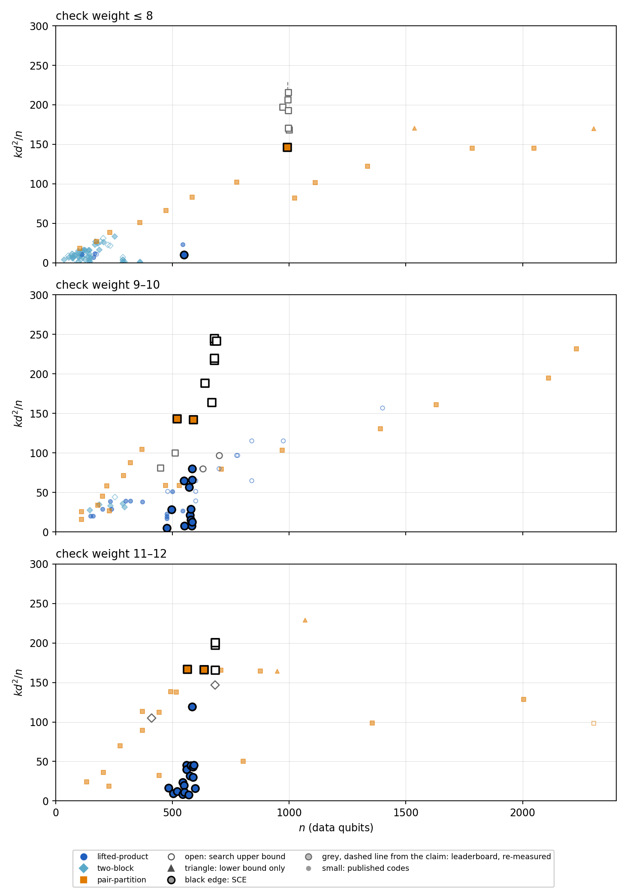

# qldpc-verified-board

Quantum LDPC codes found by structured concept evolution (SCE, arXiv:2606.24808) and entries of the Unitary Foundation
qLDPC challenge re-measured with the same search (encoding rate k/n above 0.1 for now). Every distance statement says
what is actually proven, with the files needed to check it. Site: the `docs/` folder (GitHub Pages). Data: `codes/*.json`, one entry per code.

## k d²/n against n



Three check-weight bands. Small markers are published codes (parameters as printed: the literature survey of 2026-10-18 and
the pair-partition catalogue of arXiv:2609.30069); black-edged markers are codes found by SCE; grey markers with a dashed
line are leaderboard entries, drawn from the claimed distance down to the lightest operator we found. Filled: exact
distance; open: search upper bound; triangle: lower bound only. `tools/build_site.py` redraws it from the data.

## Codes

Generated by `tools/build_site.py` from `codes/*.json`; rows are sorted by k d²/n, largest first. Entries with k/n at or below 0.1 are kept in `codes/` but not listed yet.

<!-- codes:start -->
### Summary

- check weight ≤ 8, best certified code found by SCE: **[[992,252,24]]**, k d²/n = 146.3, pair-partition (group (C_4 ⋊ C_2) × C_31 = D_4 × C_31 acting on the 124 points of C_4 × C_31 by affine maps x → ±x + c, template (3, 8)) [H_X](matrices/pp-992-252-0e23013f/HX.mtx) [H_Z](matrices/pp-992-252-0e23013f/HZ.mtx) [operators](witnesses/pp-992-252-0e23013f.json)
- check weight 9–10, best certified code found by SCE: **[[520,110,26]]**, k d²/n = 143.0, pair-partition (group C_2 × C_2 × C_13 (order 52, not cyclic), template (4, 10)) [H_X](matrices/pp-520-110-7285ad37/HX.mtx) [H_Z](matrices/pp-520-110-7285ad37/HZ.mtx) [operators](witnesses/pp-520-110-7285ad37.json)
- check weight 11–12, best certified code found by SCE: **[[564,194,22]]**, k d²/n = 166.5, pair-partition (cyclic group C_47, template (J, L) = (4, 12)) [H_X](matrices/pp-564-194-60f2ec0b/HX.mtx) [H_Z](matrices/pp-564-194-60f2ec0b/HZ.mtx) [operators](witnesses/pp-564-194-60f2ec0b.json)
- best search bound: **[[680,144,≤34]]**, k d²/n = 244.8, check weight 10, lightest operators published [H_X](matrices/pp-680-144-48ce3d43/HX.mtx) [H_Z](matrices/pp-680-144-48ce3d43/HZ.mtx) [operators](witnesses/pp-680-144-48ce3d43.json); the true distance may be smaller
- leaderboard claims not reproduced (1 of 12 re-measured): [[994,142]] claimed d ≤ 40, operator of weight 38 found [operators](witnesses/board-994-142-40.json) [entry](https://github.com/unitaryfoundation/qldpc-challenge/blob/eb2aeae/codes/994-142-40.json)

### Codes found by SCE (45 rows; ×2 = two inequivalent codes)

| code | w | k d²/n | family | status | construction | evidence | files |
|---|---|---|---|---|---|---|---|
| [[680,144,≤34]] | 10 | 244.8 | pair-partition | search bound | cyclic group C_68 (written C_4 × C_17 by the program), template (4, 10) | GPU directed BP+OSD search (v5): 600 s × 2 and 3600 s × 2 (v5): 34 in all four | [H_X](matrices/pp-680-144-48ce3d43/HX.mtx) [H_Z](matrices/pp-680-144-48ce3d43/HZ.mtx) [operators](witnesses/pp-680-144-48ce3d43.json) |
| [[680,142,≤34]] | 10 | 241.4 | pair-partition | search bound | group C_2 × C_34 (order 68), template (4, 10) | GPU directed BP+OSD search (v5): 600 s × 3 and 3600 s × 3 (v5): 34, 36, 36, 34, 34, 34 | [H_X](matrices/pp-680-142-54579668/HX.mtx) [H_Z](matrices/pp-680-142-54579668/HZ.mtx) [operators](witnesses/pp-680-142-54579668.json) |
| [[690,144,≤34]] | 10 | 241.2 | pair-partition | search bound | cyclic group C_69 (written C_3 × C_23 by the program), template (4, 10) | GPU directed BP+OSD search (v5): 600 s × 3 and 3600 s × 3 (v5): 34 in all six | [H_X](matrices/pp-690-144-ea020f49/HX.mtx) [H_Z](matrices/pp-690-144-ea020f49/HZ.mtx) [operators](witnesses/pp-690-144-ea020f49.json) |
| [[680,146,≤32]] | 10 | 219.9 | pair-partition | search bound | group C_2 × C_34, template (4, 10) | GPU directed BP+OSD search (v5): 600 s × 4 and 3600 s × 2 (v5): lightest 28 (earlier run, operator not saved); the stored operators have weight 32 | [H_X](matrices/pp-680-146-41bbe895/HX.mtx) [H_Z](matrices/pp-680-146-41bbe895/HZ.mtx) [operators](witnesses/pp-680-146-41bbe895.json) |
| [[680,144,≤32]] | 10 | 216.8 | pair-partition | search bound | group C_2 × C_34, template (4, 10) | GPU directed BP+OSD search (v5): 600 s × 4 and 3600 s × 2 (v5): 32 | [H_X](matrices/pp-680-144-c6873368/HX.mtx) [H_Z](matrices/pp-680-144-c6873368/HZ.mtx) [operators](witnesses/pp-680-144-c6873368.json) |
| [[684,238,≤24]] ×2 | 12 | 200.4 | pair-partition | search bound | cyclic group C_57 (written C_3 × C_19 by the program), template (4, 12) | GPU directed BP+OSD search (v5): 600 s × 3 and 3600 s × 2 (v5): 24 | [H_X](matrices/pp-684-238-34b56e79/HX.mtx) [H_Z](matrices/pp-684-238-34b56e79/HZ.mtx) [operators](witnesses/pp-684-238-34b56e79.json) · [H_X](matrices/pp-684-238-e403972b/HX.mtx) [H_Z](matrices/pp-684-238-e403972b/HZ.mtx) [operators](witnesses/pp-684-238-e403972b.json) |
| [[684,234,≤24]] | 12 | 197.1 | pair-partition | search bound | cyclic group C_57 (written C_3 × C_19 by the program), template (4, 12), shortened | GPU directed BP+OSD search (v5): 600 s × 3 and 3600 s × 2 (v5): 24 | [H_X](matrices/pp-684-234-aa0979d7/HX.mtx) [H_Z](matrices/pp-684-234-aa0979d7/HZ.mtx) [operators](witnesses/pp-684-234-aa0979d7.json) |
| [[640,134,≤30]] | 10 | 188.4 | pair-partition | search bound | group C_2 × C_32 (order 64), template (4, 10) | GPU directed BP+OSD search (v5): 600 s × 4 and 3600 s × 2 (v5): 30 | [H_X](matrices/pp-640-134-b9df990a/HX.mtx) [H_Z](matrices/pp-640-134-b9df990a/HZ.mtx) [operators](witnesses/pp-640-134-b9df990a.json) |
| [[564,194,22]] | 12 | 166.5 | pair-partition | exact | cyclic group C_47, template (J, L) = (4, 12) | certificate: no logical operator of weight ≤ 20 on either side, and all logical weights are even (all-ones vector in both row spaces), so d ≥ 22; explicit operators of weight 22 | [H_X](matrices/pp-564-194-60f2ec0b/HX.mtx) [H_Z](matrices/pp-564-194-60f2ec0b/HZ.mtx) [operators](witnesses/pp-564-194-60f2ec0b.json) |
| [[636,218,22]] ×2 | 12 | 165.9 | pair-partition | exact | cyclic group C_53, template (4, 12) | certificate: no logical operator of weight ≤ 20 on either side, and all logical weights are even (all-ones vector in both row spaces), so d ≥ 22; explicit operators of weight 22 | [H_X](matrices/pp-636-218-724fb874/HX.mtx) [H_Z](matrices/pp-636-218-724fb874/HZ.mtx) [operators](witnesses/pp-636-218-724fb874.json) · [H_X](matrices/pp-636-218-e247724a/HX.mtx) [H_Z](matrices/pp-636-218-e247724a/HZ.mtx) [operators](witnesses/pp-636-218-e247724a.json) |
| [[684,234,≤22]] | 12 | 165.6 | pair-partition | search bound | cyclic group C_57 (written C_3 × C_19 by the program), template (4, 12), shortened | GPU directed BP+OSD search (v5): 600 s × 3 and 3600 s × 2 (v5): 22 | [H_X](matrices/pp-684-234-72b747aa/HX.mtx) [H_Z](matrices/pp-684-234-72b747aa/HZ.mtx) [operators](witnesses/pp-684-234-72b747aa.json) |
| [[670,140,≤28]] | 10 | 163.8 | pair-partition | search bound | cyclic group C_67, template (4, 10) with one row removed | GPU directed BP+OSD search (v5): 600 s × 3 and 3600 s × 2 (v5): 28 | [H_X](matrices/pp-670-140-15e94ea5/HX.mtx) [H_Z](matrices/pp-670-140-15e94ea5/HZ.mtx) [operators](witnesses/pp-670-140-15e94ea5.json) |
| [[992,252,24]] | 8 | 146.3 | pair-partition | exact | group (C_4 ⋊ C_2) × C_31 = D_4 × C_31 acting on the 124 points of C_4 × C_31 by affine maps x → ±x + c, template (3, 8) | certificate: no logical operator of weight ≤ 22 on either side, and all logical weights are even (all-ones vector in both row spaces), so d ≥ 24; explicit operators of weight 24 | [H_X](matrices/pp-992-252-0e23013f/HX.mtx) [H_Z](matrices/pp-992-252-0e23013f/HZ.mtx) [operators](witnesses/pp-992-252-0e23013f.json) |
| [[520,110,26]] | 10 | 143.0 | pair-partition | exact | group C_2 × C_2 × C_13 (order 52, not cyclic), template (4, 10) | certificate: no logical operator of weight ≤ 24 on either side, and all logical weights are even (all-ones vector in both row spaces), so d ≥ 26; explicit operators of weight 26 | [H_X](matrices/pp-520-110-7285ad37/HX.mtx) [H_Z](matrices/pp-520-110-7285ad37/HZ.mtx) [operators](witnesses/pp-520-110-7285ad37.json) |
| [[590,124,26]] | 10 | 142.1 | pair-partition | exact | cyclic group C_59, template (4, 10) | certificate: no logical operator of weight ≤ 24 on either side, and all logical weights are even (all-ones vector in both row spaces), so d ≥ 26; explicit operators of weight 26 | [H_X](matrices/pp-590-124-64d91a4a/HX.mtx) [H_Z](matrices/pp-590-124-64d91a4a/HZ.mtx) [operators](witnesses/pp-590-124-64d91a4a.json) |
| [[585,121,24]] | 12 | 119.1 | lifted-product | exact | group C_13 ⋊ C_9 (order 117), protograph shapes (1,2) × (1,2) | certificate: no logical operator of weight ≤ 23 on either side; explicit operators of weight 24 | [H_X](matrices/lp-585-121-dc333332/HX.mtx) [H_Z](matrices/lp-585-121-dc333332/HZ.mtx) [operators](witnesses/lp-585-121-dc333332.json) |
| [[585,117,20]] | 9 | 80.0 | lifted-product | exact | group C_13 ⋊ C_9 (order 117), protograph shapes (1,2) × (1,2) | certificate: no logical operator of weight ≤ 19 on either side; explicit operators of weight 20 | [H_X](matrices/lp-585-117-c841b78f/HX.mtx) [H_Z](matrices/lp-585-117-c841b78f/HZ.mtx) [operators](witnesses/lp-585-117-c841b78f.json) |
| [[585,119,18]] | 9 | 65.9 | lifted-product | exact | group C_13 ⋊ C_9 (order 117), protograph shapes (1,2) × (1,2) | certificate: no logical operator of weight ≤ 17 on either side; explicit operators of weight 18 | [H_X](matrices/lp-585-119-8bd2c5b8/HX.mtx) [H_Z](matrices/lp-585-119-8bd2c5b8/HZ.mtx) [operators](witnesses/lp-585-119-8bd2c5b8.json) |
| [[550,110,18]] | 9 | 64.8 | lifted-product | exact | group C_11 ⋊ C_10 (order 110), protograph shapes (1,2) × (1,2) | certificate: no logical operator of weight ≤ 17 on either side; explicit operators of weight 18 | [H_X](matrices/lp-550-110-f018ef54/HX.mtx) [H_Z](matrices/lp-550-110-f018ef54/HZ.mtx) [operators](witnesses/lp-550-110-f018ef54.json) |
| [[572,67,22]] | 10 | 56.7 | lifted-product | exact | group Dic_11 (order 44), protograph shapes (2,3) × (2,3) | certificate: no logical operator of weight ≤ 21 on either side; explicit operators of weight 22 | [H_X](matrices/lp-572-67-82b2bf20/HX.mtx) [H_Z](matrices/lp-572-67-82b2bf20/HZ.mtx) [operators](witnesses/lp-572-67-82b2bf20.json) |
| [[560,130,14]] | 12 | 45.5 | lifted-product | exact | group Dic_7 (order 28), protograph shapes (2,4) × (2,4) | certificate: no logical operator of weight ≤ 13 on either side; explicit operators of weight 14 | [H_X](matrices/lp-560-130-d233cc72/HX.mtx) [H_Z](matrices/lp-560-130-d233cc72/HZ.mtx) [operators](witnesses/lp-560-130-d233cc72.json) |
| [[592,83,18]] | 12 | 45.4 | lifted-product | exact | group C_37 (order 37), protograph shapes (2,3) × (2,4) | certificate: no logical operator of weight ≤ 17 on either side; explicit operators of weight 18 | [H_X](matrices/lp-592-83-3c772243/HX.mtx) [H_Z](matrices/lp-592-83-3c772243/HZ.mtx) [operators](witnesses/lp-592-83-3c772243.json) |
| [[580,132,14]] | 12 | 44.6 | lifted-product | exact | group C_29 (order 29), protograph shapes (2,4) × (2,4) | certificate: no logical operator of weight ≤ 13 on either side; explicit operators of weight 14 | [H_X](matrices/lp-580-132-239bca5f/HX.mtx) [H_Z](matrices/lp-580-132-239bca5f/HZ.mtx) [operators](witnesses/lp-580-132-239bca5f.json) |
| [[588,176,12]] | 12 | 43.1 | lifted-product | exact | group Dic_21 (order 84), protograph shapes (1,2) × (1,3) | certificate: no logical operator of weight ≤ 11 on either side; explicit operators of weight 12 | [H_X](matrices/lp-588-176-b51b14af/HX.mtx) [H_Z](matrices/lp-588-176-b51b14af/HZ.mtx) [operators](witnesses/lp-588-176-b51b14af.json) |
| [[560,224,10]] | 12 | 40.0 | lifted-product | exact | group AGL(1,8) (order 56), protograph shapes (1,3) × (1,3) | certificate: no logical operator of weight ≤ 9 on either side; explicit operators of weight 10 | [H_X](matrices/lp-560-224-db18259e/HX.mtx) [H_Z](matrices/lp-560-224-db18259e/HZ.mtx) [operators](witnesses/lp-560-224-db18259e.json) |
| [[576,82,15]] | 11 | 32.0 | lifted-product | exact | group Dic_9 (order 36), protograph shapes (2,3) × (2,4) | certificate: no logical operator of weight ≤ 14 on either side; explicit operators of weight 15 | [H_X](matrices/lp-576-82-30b645d7/HX.mtx) [H_Z](matrices/lp-576-82-30b645d7/HZ.mtx) [operators](witnesses/lp-576-82-30b645d7.json) |
| [[588,176,10]] | 12 | 29.9 | lifted-product | exact | group C_2 × (C_7 ⋊ C_3) (order 42), protograph shapes (1,2) × (2,6) | certificate: no logical operator of weight ≤ 9 on either side; explicit operators of weight 10 | [H_X](matrices/lp-588-176-7084834c/HX.mtx) [H_Z](matrices/lp-588-176-7084834c/HZ.mtx) [operators](witnesses/lp-588-176-7084834c.json) |
| [[580,116,12]] | 10 | 28.8 | lifted-product | exact | group C_29 (order 29), protograph shapes (2,4) × (2,4) | certificate: no logical operator of weight ≤ 11 on either side; explicit operators of weight 12 | [H_X](matrices/lp-580-116-ba427de1/HX.mtx) [H_Z](matrices/lp-580-116-ba427de1/HZ.mtx) [operators](witnesses/lp-580-116-ba427de1.json) |
| [[496,72,14]] | 9 | 28.4 | lifted-product | exact | group C_31 (order 31), protograph shapes (2,3) × (2,4) | certificate: no logical operator of weight ≤ 13 on either side; explicit operators of weight 14 | [H_X](matrices/lp-496-72-e23c4a10/HX.mtx) [H_Z](matrices/lp-496-72-e23c4a10/HZ.mtx) [operators](witnesses/lp-496-72-e23c4a10.json) |
| [[544,200,8]] | 12 | 23.5 | lifted-product | exact | group Q_16 (order 16), protograph shapes (2,5) × (2,6) | certificate: no logical operator of weight ≤ 7 on either side; explicit operators of weight 8 | [H_X](matrices/lp-544-200-15d39679/HX.mtx) [H_Z](matrices/lp-544-200-15d39679/HZ.mtx) [operators](witnesses/lp-544-200-15d39679.json) |
| [[576,150,9]] | 9 | 21.1 | lifted-product | exact | group C_3 ⋊ C_16 (order 48), protograph shapes (1,2) × (2,5) | certificate: no logical operator of weight ≤ 8 on either side; explicit operators of weight 9 | [H_X](matrices/lp-576-150-38483df5/HX.mtx) [H_Z](matrices/lp-576-150-38483df5/HZ.mtx) [operators](witnesses/lp-576-150-38483df5.json) |
| [[550,220,7]] | 11 | 19.6 | lifted-product | exact | group C_11 ⋊ C_5 (order 55), protograph shapes (1,3) × (1,3) | certificate: no logical operator of weight ≤ 6 on either side; explicit operators of weight 7 | [H_X](matrices/lp-550-220-d8d92f24/HX.mtx) [H_Z](matrices/lp-550-220-d8d92f24/HZ.mtx) [operators](witnesses/lp-550-220-d8d92f24.json) |
| [[483,220,6]] | 12 | 16.4 | lifted-product | exact | group C_7 ⋊ C_3 (order 21), protograph shapes (1,3) × (2,7) | certificate: no logical operator of weight ≤ 5 on either side; explicit operators of weight 6 | [H_X](matrices/lp-483-220-b7bb3363/HX.mtx) [H_Z](matrices/lp-483-220-b7bb3363/HZ.mtx) [operators](witnesses/lp-483-220-b7bb3363.json) |
| [[598,195,7]] | 12 | 16.0 | lifted-product | exact | group C_13 (order 13), protograph shapes (2,5) × (3,8) | certificate: no logical operator of weight ≤ 6 on either side; explicit operators of weight 7 | [H_X](matrices/lp-598-195-8031fd1f/HX.mtx) [H_Z](matrices/lp-598-195-8031fd1f/HZ.mtx) [operators](witnesses/lp-598-195-8031fd1f.json) |
| [[580,180,7]] | 9 | 15.2 | lifted-product | exact | group C_5 ⋊ C_4 (order 20), protograph shapes (2,5) × (2,5) | certificate: no logical operator of weight ≤ 6 on either side; explicit operators of weight 7 | [H_X](matrices/lp-580-180-67395015/HX.mtx) [H_Z](matrices/lp-580-180-67395015/HZ.mtx) [operators](witnesses/lp-580-180-67395015.json) |
| [[584,200,6]] | 9 | 12.3 | lifted-product | exact | group C_8 (order 8), protograph shapes (3,8) × (3,8) | certificate: no logical operator of weight ≤ 5 on either side; explicit operators of weight 6 | [H_X](matrices/lp-584-200-4c556c11/HX.mtx) [H_Z](matrices/lp-584-200-4c556c11/HZ.mtx) [operators](witnesses/lp-584-200-4c556c11.json) |
| [[520,252,5]] | 12 | 12.1 | lifted-product | exact | group C_5 ⋊ C_8 (order 40), protograph shapes (1,3) × (1,4) | certificate: no logical operator of weight ≤ 4 on either side; explicit operators of weight 5 | [H_X](matrices/lp-520-252-612dfb68/HX.mtx) [H_Z](matrices/lp-520-252-612dfb68/HZ.mtx) [operators](witnesses/lp-520-252-612dfb68.json) |
| [[552,240,5]] | 12 | 10.9 | lifted-product | exact | group C_3 ⋊ C_8 (order 24), protograph shapes (1,3) × (2,7) | certificate: no logical operator of weight ≤ 4 on either side; explicit operators of weight 5 | [H_X](matrices/lp-552-240-ccf067d3/HX.mtx) [H_Z](matrices/lp-552-240-ccf067d3/HZ.mtx) [operators](witnesses/lp-552-240-ccf067d3.json) |
| [[550,226,5]] | 8 | 10.3 | lifted-product | exact | group C_11 ⋊ C_5 (order 55), protograph shapes (1,3) × (1,3) | certificate: no logical operator of weight ≤ 4 on either side; explicit operators of weight 5 | [H_X](matrices/lp-550-226-aa1b8eb1/HX.mtx) [H_Z](matrices/lp-550-226-aa1b8eb1/HZ.mtx) [operators](witnesses/lp-550-226-aa1b8eb1.json) |
| [[504,297,4]] | 12 | 9.4 | lifted-product | exact | group S_3 × C_4 (order 24), protograph shapes (1,4) × (1,5) | certificate: no logical operator of weight ≤ 3 on either side; explicit operators of weight 4 | [H_X](matrices/lp-504-297-cf5015a2/HX.mtx) [H_Z](matrices/lp-504-297-cf5015a2/HZ.mtx) [operators](witnesses/lp-504-297-cf5015a2.json) |
| [[544,288,4]] | 12 | 8.5 | lifted-product | exact | group SD_32 (order 32), protograph shapes (1,4) × (1,4) | certificate: no logical operator of weight ≤ 3 on either side; explicit operators of weight 4 | [H_X](matrices/lp-544-288-217b1dab/HX.mtx) [H_Z](matrices/lp-544-288-217b1dab/HZ.mtx) [operators](witnesses/lp-544-288-217b1dab.json) |
| [[570,288,4]] | 12 | 8.1 | lifted-product | exact | group C_19 (order 19), protograph shapes (1,4) × (2,7) | certificate: no logical operator of weight ≤ 3 on either side; explicit operators of weight 4 | [H_X](matrices/lp-570-288-f4eda3e5/HX.mtx) [H_Z](matrices/lp-570-288-f4eda3e5/HZ.mtx) [operators](witnesses/lp-570-288-f4eda3e5.json) |
| [[583,287,4]] | 9 | 7.9 | lifted-product | exact | group C_11 (order 11), protograph shapes (2,7) × (2,7) | certificate: no logical operator of weight ≤ 3 on either side; explicit operators of weight 4 | [H_X](matrices/lp-583-287-ac08dff0/HX.mtx) [H_Z](matrices/lp-583-287-ac08dff0/HZ.mtx) [operators](witnesses/lp-583-287-ac08dff0.json) |
| [[552,258,4]] | 9 | 7.5 | lifted-product | exact | group C_12 ⋊ C_2 (order 24), protograph shapes (1,3) × (2,7) | certificate: no logical operator of weight ≤ 3 on either side; explicit operators of weight 4 | [H_X](matrices/lp-552-258-8f79c779/HX.mtx) [H_Z](matrices/lp-552-258-8f79c779/HZ.mtx) [operators](witnesses/lp-552-258-8f79c779.json) |
| [[476,252,3]] | 9 | 4.8 | lifted-product | exact | group Dic_7 (order 28), protograph shapes (1,4) × (1,4) | certificate: no logical operator of weight ≤ 2 on either side; explicit operators of weight 3 | [H_X](matrices/lp-476-252-945df1a1/HX.mtx) [H_Z](matrices/lp-476-252-945df1a1/HZ.mtx) [operators](witnesses/lp-476-252-945df1a1.json) |

### Leaderboard entries re-measured (12)

| entry | w | claimed d | lightest operator we found | k d²/n claimed → re-measured | our search | files |
|---|---|---|---|---|---|---|
| [[996,166]] | 8 | ≤36 | held (nothing lighter found) | 216 | 600 s seed 0: 36; 600 s seed 1: 36; 3600 s seed 0: 36; 3600 s seed 1: 36; 600 s seed 4: 36; the claimed distance held | [operators](witnesses/board-996-166-36.json) [entry](https://github.com/unitaryfoundation/qldpc-challenge/blob/eb2aeae/codes/996-166-36.json) |
| [[994,142]] | 8 | ≤40 | 38 | 229 → 206 | 600 s seed 0: 38; 600 s seed 1: 38; 3600 s seed 0: 38; 3600 s seed 1: 38; lighter operators than the claim exist, see th | [operators](witnesses/board-994-142-40.json) [entry](https://github.com/unitaryfoundation/qldpc-challenge/blob/eb2aeae/codes/994-142-40.json) |
| [[972,166]] | 8 | ≤34 | held (nothing lighter found) | 197 | 600 s seed 0: 34; 600 s seed 1: 34; 3600 s seed 0: 34; 3600 s seed 1: 34; 600 s seed 4: 34; the claimed distance held | [operators](witnesses/board-972-166-34.json) [entry](https://github.com/unitaryfoundation/qldpc-challenge/blob/eb2aeae/codes/972-166-34.json) |
| [[996,166]] | 8 | ≤34 | held (nothing lighter found) | 193 | 600 s seed 0: 34; 600 s seed 1: 34; 3600 s seed 0: 34; 3600 s seed 1: 34; 600 s seed 4: 34; the claimed distance held | [operators](witnesses/board-996-166-34.json) [entry](https://github.com/unitaryfoundation/qldpc-challenge/blob/eb2aeae/codes/996-166-34.json) |
| [[996,166]] | 8 | ≤32 | held (nothing lighter found) | 171 | 600 s seed 0: 32; 600 s seed 1: 32; 3600 s seed 0: 32; 3600 s seed 1: 32; 600 s seed 4: 32; the claimed distance held | [operators](witnesses/board-996-166-32.json) [entry](https://github.com/unitaryfoundation/qldpc-challenge/blob/eb2aeae/codes/996-166-32.json) |
| [[1000,200]] | 8 | ≤29 | held (nothing lighter found) | 168 | 600 s seed 0: 29; 600 s seed 1: 29; 3600 s seed 0: 29; 3600 s seed 1: 29; 600 s seed 4: 29; the claimed distance held | [operators](witnesses/board-1000-200-29.json) [entry](https://github.com/unitaryfoundation/qldpc-challenge/blob/eb2aeae/codes/1000-200-29.json) |
| [[682,82]] | 12 | ≤35 | held (nothing lighter found) | 147 | 600 s seed 0: 35; 600 s seed 1: 35; 3600 s seed 0: 35; 3600 s seed 1: 35; the claimed distance held | [operators](witnesses/board-682-82-35.json) [entry](https://github.com/unitaryfoundation/qldpc-challenge/blob/eb2aeae/codes/682-82-35.json) |
| [[410,48]] | 12 | ≤30 | held (nothing lighter found) | 105 | 600 s seed 0: 30; 600 s seed 1: 30; 3600 s seed 0: 30; 3600 s seed 1: 30; 600 s seed 4: 30; the claimed distance held | [operators](witnesses/board-410-48-30.json) [entry](https://github.com/unitaryfoundation/qldpc-challenge/blob/eb2aeae/codes/410-48-30.json) |
| [[512,128]] | 10 | ≤20 | held (nothing lighter found) | 100 | 600 s seed 0: 20; 600 s seed 1: 20; 3600 s seed 0: 20; 3600 s seed 1: 20; the claimed distance held | [operators](witnesses/board-512-128-20.json) [entry](https://github.com/unitaryfoundation/qldpc-challenge/blob/eb2aeae/codes/512-128-20.json) |
| [[700,140]] | 9 | ≤22 | held (nothing lighter found) | 97 | 600 s seed 0: 22; 600 s seed 1: 22; 3600 s seed 0: 22; 3600 s seed 1: 22; the claimed distance held | [operators](witnesses/board-700-140-22.json) [entry](https://github.com/unitaryfoundation/qldpc-challenge/blob/eb2aeae/codes/700-140-22.json) |
| [[448,112]] | 10 | ≤18 | held (nothing lighter found) | 81 | 600 s seed 0: 18; 600 s seed 1: 18; 3600 s seed 0: 18; 3600 s seed 1: 18; the claimed distance held | [operators](witnesses/board-448-112-18.json) [entry](https://github.com/unitaryfoundation/qldpc-challenge/blob/eb2aeae/codes/448-112-18.json) |
| [[630,126]] | 9 | ≤20 | held (nothing lighter found) | 80 | 600 s seed 0: 20; 600 s seed 1: 20; 3600 s seed 0: 20; 3600 s seed 1: 20; the claimed distance held | [operators](witnesses/board-630-126-20.json) [entry](https://github.com/unitaryfoundation/qldpc-challenge/blob/eb2aeae/codes/630-126-20.json) |
<!-- codes:end -->

## What a row means

- **exact** distance `d`: a certificate shows that no logical operator of weight below `d` exists on either side
  (irreducible-cluster enumeration, Dumer–Kovalev–Pryadko 2017, with Tanner-graph automorphism orbits; for the
  pair-partition codes together with the even-weight argument: the all-ones vector lies in the row spaces of H_X and
  H_Z, so every logical operator has even weight), and an explicit logical operator of weight `d` is given in
  `witnesses/`. Rows whose operator file has not been stored yet are marked "operator file pending".
- **search bound** `d ≤ w`: the lightest logical operator found by a long GPU search (directed BP+OSD with 128-column
  ordered statistics, several runs of 600 s to 3600 s). The operator is published in `witnesses/` so anyone can check
  it; the true distance may be smaller.
- **lower bound** `d ≥ w`: a certificate without a matching operator.

Entries marked *leaderboard, re-measured* are codes of the Unitary Foundation qLDPC challenge
(github.com/unitaryfoundation/qldpc-challenge, snapshot eb2aeae of 2026-11-01). Their check matrices are rebuilt from
the entry's check lists and are not copied here; the row gives the claimed distance, the lightest operator our search
found, and the operator itself, which can be verified against the entry file linked in the row.

## Files

- `codes/<slug>.json` the entry: parameters, family, construction, source, the distance evidence, links to files.
- `matrices/<slug>/HX.mtx`, `HZ.mtx` check matrices (MatrixMarket, pattern, 1-based).
- `witnesses/<slug>.json` supports (0-based qubit indices) of verified logical operators, lists `wx` and `wz`.
- `data/published_codes.json` parameters of published codes used as reference points in the figure (no matrices).
- `tools/verify.py` checks one code and its operators; `tools/check_all.py` checks every entry (CSS condition, n, k,
  check weights, every listed operator, the even-weight condition where a certificate uses it; it does not re-run the
  exact enumerations);
  `tools/build_site.py` regenerates `docs/`; `tools/npz_to_mtx.py` converts archived matrices.

```
python tools/verify.py matrices/pp-564-194-60f2ec0b/HX.mtx matrices/pp-564-194-60f2ec0b/HZ.mtx witnesses/pp-564-194-60f2ec0b.json
python tools/check_all.py
```

## Sources of the entries

- The lifted-product codes of arXiv:2606.24808 (v2) with their certificates (repository ziduliu/sce-qldpc).
- Pair-partition codes (construction of arXiv:2609.30069, Lee et al.) found by our program-evolution framework in
  October and November 2026, certified or long-searched as stated per row.
- Re-measured leaderboard entries.

## Submitting a code

Open a pull request with `codes/<slug>.json` and the two check matrices (MatrixMarket, as in `matrices/`), or an
issue with the files attached. We run the same search and, where feasible, the certifier, and add the result as a row
with the evidence. Entries are never listed with a distance that has not been checked here.

## License

Apache License 2.0 (`LICENSE`).
